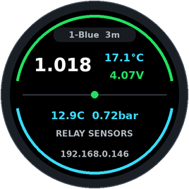
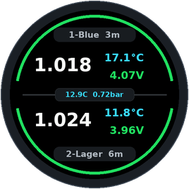
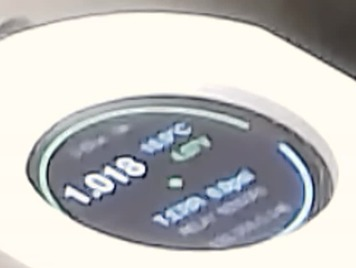
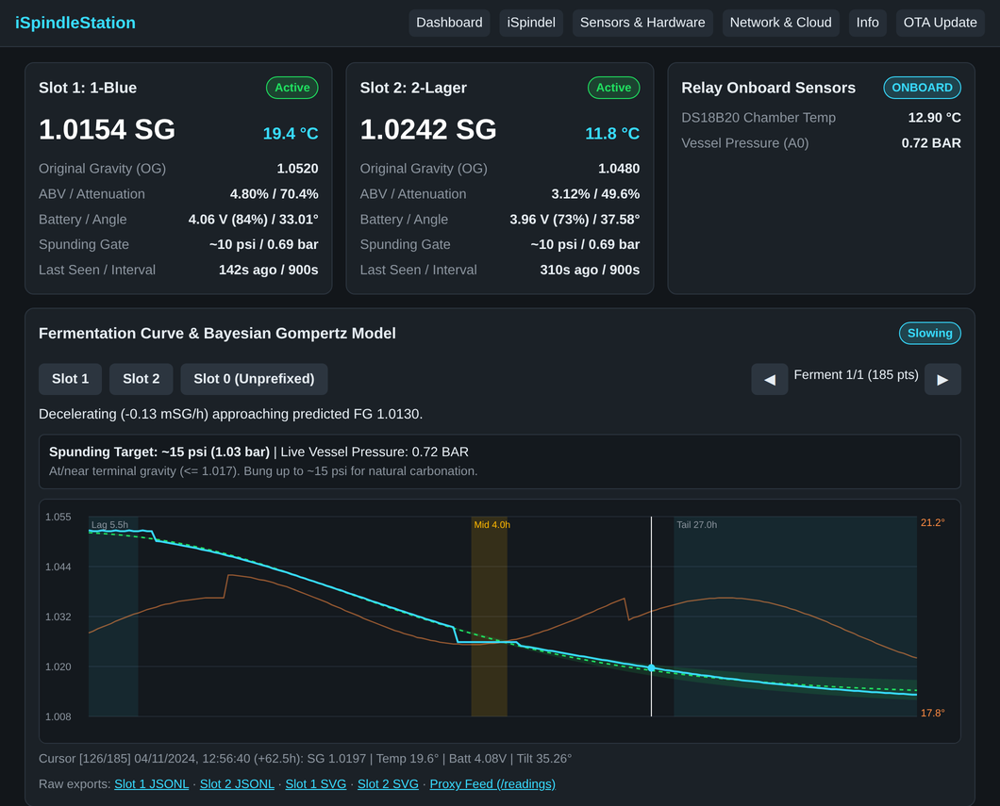
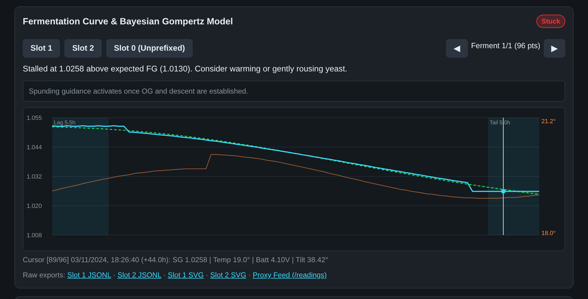
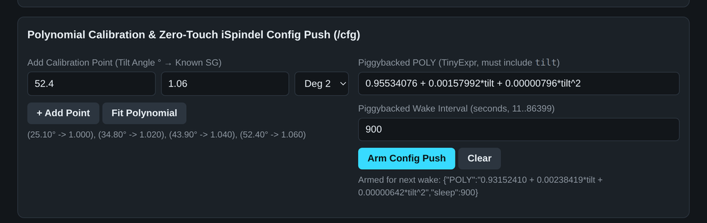

<h1 align="center">iSpindleStation</h1>

<p align="center">
  Open-source ESP8266 firmware &amp; fermentation analytics station for iSpindel hydrometers —<br/>
  GC9A01 240×240 round TFT · onboard DS18B20 &amp; vessel pressure transducer · piezo alarms · buffering <code>ispindle-proxy</code> with zero-touch hydrometer config/OTA push · Bayesian Gompertz curve fitting · 12 cloud &amp; Home Assistant MQTT forwarders
</p>

<p align="center">
  <a href="https://github.com/GlassOnTin/iSpindleStation/commits/main"></a>
  <a href="LICENSE"></a>
  
  
  
  <a href="https://github.com/GlassOnTin/iSpindlePlotter"></a>
  <a href="https://ko-fi.com/glassontin"></a>
</p>

<p align="center">
  <a href="docs/hardware.md">Hardware Architecture</a> &bull;
  <a href="docs/features.md">Feature Specification</a> &bull;
  <a href="docs/protocol.md">HTTP &amp; Config Surface</a> &bull;
  <a href="https://github.com/GlassOnTin/iSpindlePlotter">iSpindlePlotter Android App</a>
</p>

---

### Round GC9A01 240×240 TFT Display

<p align="center">
  
  &nbsp;&nbsp;
  
  &nbsp;&nbsp;
  
</p>

<p align="center">
  <sub><b>Left:</b> Single iSpindel in upper hemisphere with onboard DS18B20 temperature &amp; vessel pressure in lower hemisphere. &nbsp;|&nbsp; <b>Center:</b> Simultaneous dual-iSpindel view with onboard relay sensors in the equator pill. &nbsp;|&nbsp; <b>Right:</b> Live iRelay NXT hardware running <code>v0.4.0</code>.</sub>
</p>

---

### On-Device Web UI — Bayesian Gompertz Fitting, Phase Guidance &amp; Zero-Touch Calibration

<p align="center">
  
</p>

<p align="center">
  <sub><b>Dashboard &amp; Bayesian Modified-Gompertz Model:</b> Dual-slot telemetry cards, onboard DS18B20 &amp; vessel pressure card, 7-phase state classification (<code>Slowing</code>), live spunding-valve pressure target paired with the <code>A0</code> transducer, shaded <code>Lag</code> / <code>Mid</code> (diauxic shift) / <code>Tail</code> plateaus, and dashed Gompertz curve with 95% credible band.</sub>
</p>

<p align="center">
  
  &nbsp;
  
</p>

<p align="center">
  <sub><b>Left:</b> Mid-ferment stall / stuck fermentation detection with rousing &amp; temperature guidance and spunding lockout. &nbsp;|&nbsp; <b>Right:</b> Degree 1–3 OLS polynomial calibration (<code>SG = f(tilt)</code>) and zero-touch piggybacked <code>POST /gravity</code> config push (<code>/cfg</code>).</sub>
</p>

---

## At a Glance

- **[GC9A01 240×240 Round TFT](src/display.h)** — Simultaneous upper/lower hemisphere layout for two iSpindels (Specific Gravity or °Plato, temperature, battery voltage, perimeter status/alarm arcs, and center heartbeat dot), plus live onboard relay DS18B20 temperature and vessel pressure readout, runtime backlight (`GPIO 15`), and 4-way rotation (`0..3`).
- **[Hardware Peripherals & Alarms](src/sensors.h)** — Piezo buzzer (`GPIO 12`, 1800 Hz save confirmation and 2000 Hz alarm tone), onboard DS18B20 1-Wire thermometer (`GPIO 2`, 11-bit non-blocking 10 s poll with 6-strike fault debounce), onboard analog pressure transducer (`A0`, 15 s poll with linear Bar/Psi calibration), and 10 configurable temperature/gravity/pressure alarm bounds.
- **[Buffering Proxy & Zero-Touch Hydrometer Management](src/proxy.h)** — Native `ispindle-proxy` compatibility: mDNS advertisement (`_ispindle-proxy._tcp` on port `80`), monotonic cursor catch-up feed (`GET /readings?since=N`), and piggybacked `POST /gravity` response configuration/OTA push (`GET/PUT/DELETE /cfg`, `/fw`, `/fw.bin`).
- **[On-Device & Browser Fermentation Analytics](src/webui.h)** — 5th-sample OG auto-lock, ABV %, apparent attenuation %, episode segmentation, bad-data exclusions (`/exclusions`), krausen-clamped OG, Levenberg-Marquardt modified-Gompertz curve fitting with 95% credible band and ETA, diauxic plateau shading, 7-phase state machine (`Lag`, `Active`, `Slowing`, `Conditioning`, `Clarifying`, `Stuck`, `ColdCrash`), degree 1–3 polynomial calibration calculator, and spunding-pressure guidance paired with live `A0` vessel pressure.
- **[Cloud & Local Forwarding](src/forwarders.h)** — 12 forwarding services (`0` UbiDots, `1` Brewfather, `2` BrewSpy, `3` Monitor.Beer, `4` Grainfather, `5` BrewPiless, `6` Little Bock, `7` Brewers Friend, `8` BrewBench, `9` MQTT + 17 Home Assistant Auto-Discovery sensors, `10` Generic HTTP `host:port`, `11` NAUTILIS Tapboard) across both on-receipt iSpindel forwarding and periodic onboard relay sensor uploads.

See [docs/features.md](docs/features.md) for the full feature specification, [docs/hardware.md](docs/hardware.md) for the hardware architecture and Mermaid diagrams, and [docs/protocol.md](docs/protocol.md) for the HTTP and `/config.json` schema.

## Build &amp; Flash

```bash
# Compile firmware (.pio/build/relay/firmware.bin)
pio run

# Flash over USB serial
pio run -t upload

# Or upload over WiFi OTA to a running station
curl -F "update=@.pio/build/relay/firmware.bin" http://<station-ip>/update
```

## Hardware Mock Test Suite

[`test/mock_test_forwarders.py`](test/mock_test_forwarders.py) starts a local mock HTTP server and mock MQTT v3.1.1 broker to test all 12 forwarding services (both on-receipt and periodic relay-sensor uploads) against a live station without altering its stored `/config.json`:

```bash
python3 test/mock_test_forwarders.py
```

## License

MIT (`LICENSE`). Vendored: `lib/WiFiManagerKT` — MIT, Ken Taylor's fork of WiFiManager.
