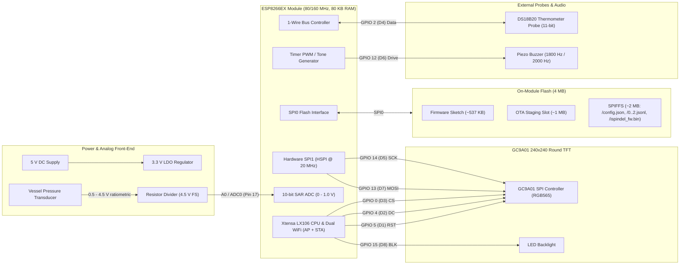
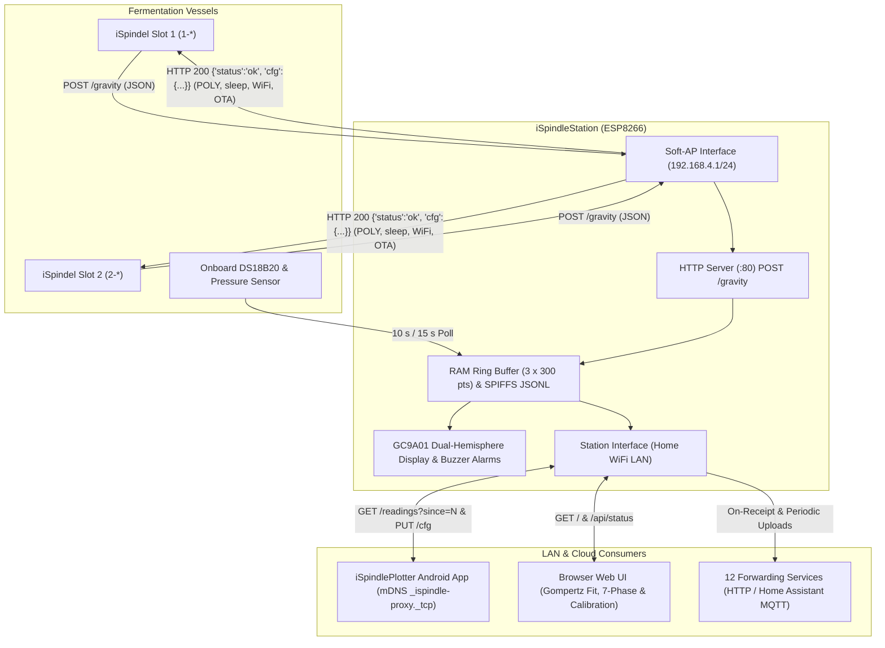

# Hardware Architecture

`iSpindleStation` targets ESP8266 relay station hardware (4 MB SPI flash) equipped with a round 240×240 GC9A01 RGB565 TFT display, a 1-Wire DS18B20 temperature probe, an analog vessel-pressure transducer, and a piezo alarm buzzer.

## Board & Peripheral Topology

## Radio & Network Dataflow

The ESP8266 radio operates in simultaneous `WIFI_AP_STA` mode so battery-powered iSpindel hydrometers can post to a dedicated local access point (`192.168.4.1/24`) while the station serves its web dashboard, syncs with the `iSpindlePlotter` Android app over mDNS, and forwards telemetry to cloud or LAN endpoints.

## GPIO Pin Assignment Summary

| ESP8266 Pin | NodeMCU Label | Direction | Connected Subsystem | Notes |
| :--- | :--- | :--- | :--- | :--- |
| `GPIO 14` | `D5` | Output | GC9A01 `SCK` | Hardware HSPI clock (`20 MHz`) |
| `GPIO 13` | `D7` | Output | GC9A01 `MOSI` | Hardware HSPI data |
| `GPIO 0` | `D3` | Output | GC9A01 `CS` | Display chip select (active low; boot strap high) |
| `GPIO 4` | `D2` | Output | GC9A01 `DC` | Display data/command select |
| `GPIO 5` | `D1` | Output | GC9A01 `RST` | Display hardware reset |
| `GPIO 15` | `D8` | Output | GC9A01 `BLK` | Backlight enable (`ledState`: `1` = On, `0` = Off; boot strap low) |
| `GPIO 12` | `D6` | Output | Piezo Buzzer | Driven low at idle; `1800 Hz` save tone (`1 s`), `2000 Hz` alarm pulse (`1 s` every `5 s`) |
| `GPIO 2` | `D4` | Bidir | DS18B20 `DQ` | 1-Wire temperature bus (`11-bit` non-blocking conversion, `10 s` poll) |
| `ADC0 (17)` | `A0` | Input (Analog) | Pressure Sensor | 10-bit ADC (`0..1023` mapped to `0..4.5 V`), linear calibration via `minpressure`, `maxpressure`, `maxpressure_bar` (`15 s` poll) |
